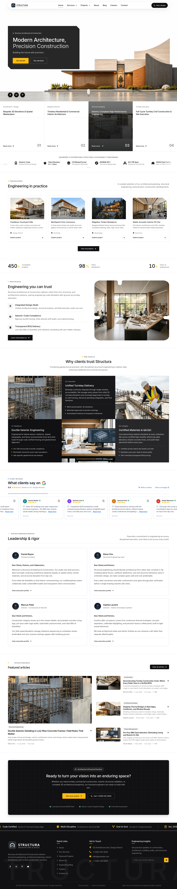

# Structura Architecture & Construction

Modern, responsive marketing, portfolio, and technical publication web application for an architecture, structural engineering, and turnkey construction studio (`construction-and-architecture-website`).

**Production Site:** [https://www.nayaabengineering.com)  
**Github:** [https://github.com/ovaiseqayoom/construction-and-architecture-website](https://github.com/ovaiseqayoom/construction-and-architecture-website)

---

## Full Home Page Preview



---

## Key Capabilities

- **Zero-Config Demo Mode:** Runs immediately with zero environment variables. When Supabase credentials are omitted, `src/lib/supabaseClient.js` safely returns `null` and every route renders curated built-in projects, technical articles, services, cost benchmarks, and team profiles.
- **Interactive Markdown Analytics (`chart` & `mermaid`):** Technical articles support fenced `mermaid` architecture/engineering flowcharts, interactive SVG `chart` JSON specifications (bar, horizontal bar, grouped bar, line, area, pie, donut), automated BLUF summaries, expandable FAQs, and scroll-synced tables of contents.
- **Project Portfolio & Interactive Galleries:** Category-filtered showcase (`Residential`, `Commercial`, `Institutional`, `Infrastructure`, `Interior & Fit-Out`) with detail views, deliverables breakdown, quick-view drawers, and lightbox inspection.
- **Construction Cost Estimator Data:** Structured architectural, structural, turnkey construction, MEP, and material cost reference models in `src/data/constructionCostDatabase.js`.
- **Smooth Scrolling & Motion:** Built with React 19, Vite, Lenis smooth scrolling, Framer Motion transitions, and route-level code splitting.
- **Build-Time SEO & SSG Prerendering:** Automated XML sitemaps, RSS feeds, Open Graph JPEG generation via `sharp`, JSON-LD schemas, and static HTML prerendering across all marketing, service, project, and blog routes, validated by `scripts/verify-seo-gates.mjs`.

---

## Quick Start (Run Locally)

Prerequisites: **Node.js 20+** and **npm 10+**. No `.env` file is required for local development or production builds.

```bash
# 1. Clone the repository
git clone https://github.com/ovaiseqayoom/construction-and-architecture-website.git
cd construction-and-architecture-website

# 2. Install dependencies
npm install

# 3. Start the local development server
npm run dev

# 4. Run linter and production build (with sitemap, RSS & SSG prerendering)
npm run lint
npm run build

# 5. Preview the built production bundle locally
npm run preview
```

---

## Architecture & Folder Structure

```text
construction-and-architecture-website/
├── api/                        # Optional Vercel serverless functions (SEO, OG, email workflows)
├── docs/                       # Documentation assets including full Home page screenshot
├── public/                     # Static brand SVGs, favicons, OG assets, robots.txt, manifest
│   └── images/                 # Local SVG illustrations for hero, projects, blog, services & team
├── scripts/                    # Build-time SEO & SSG pipeline
│   ├── generate-sitemap.js     # Generates sitemap index, page, project & blog sitemaps
│   ├── generate-rss.js         # Generates public/feed.xml from Supabase or demo content
│   ├── prerender-static-pages.js
│   ├── prerender-services.js
│   ├── prerender-projects.js
│   ├── prerender-blogs.js
│   ├── clean-dist-xml.js
│   └── verify-seo-gates.mjs    # Validates canonicals, OG images, schemas, H1s & internal links
├── src/
│   ├── components/             # Modular UI components (layout, home, projects, blog, team, common)
│   ├── config/                 # Site SEO metadata and API endpoint configuration
│   ├── data/                   # Demo content, services, team, careers, and cost database
│   ├── hooks/                  # Custom React hooks
│   ├── lib/                    # Optional Supabase client with safe zero-config fallback
│   ├── pages/                  # Route pages (Home, About, Services, Projects, Blog, Careers, Contact, Legal)
│   ├── styles/                 # Global CSS tokens and theme rules
│   └── utils/                  # Data loaders, cache helpers, Markdown/SEO/validation utilities
├── supabase/migrations/        # Database schema & RLS SQL migrations for custom backends
├── .env.example                # Optional environment variable template
├── package.json
└── vercel.json                 # Security headers, caching rules & SPA/API rewrites
```

---

## Environment Configuration

All environment variables are **optional**. To connect a live Supabase database, Resend transactional email templates, or custom endpoints:

```bash
cp .env.example .env
```

Fill in only the integrations you intend to use (`VITE_SUPABASE_URL`, `VITE_SUPABASE_ANON_KEY`, `VITE_SITE_URL`, and optional server keys for `api/`). Never commit `.env` to version control.

---

## Backend API & Admin Dashboard

For the complete **Backend API** and **Admin Dashboard** (CMS, AI Markdown & Chart builder, analytics, and lead management), contact **[www.kallis.in](https://www.kallis.in)**.

---

## License

Licensed under the [MIT License](LICENSE).
